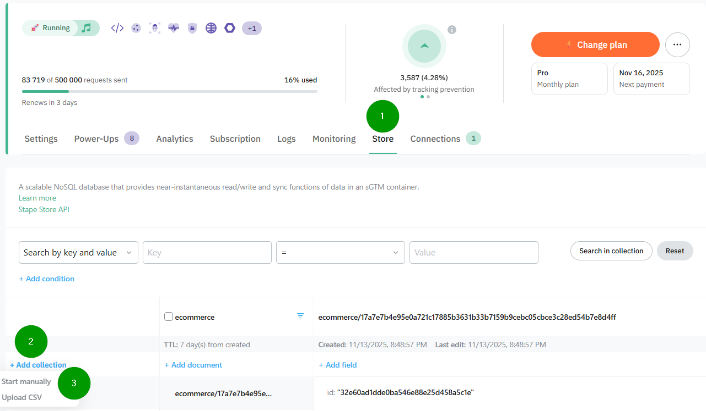
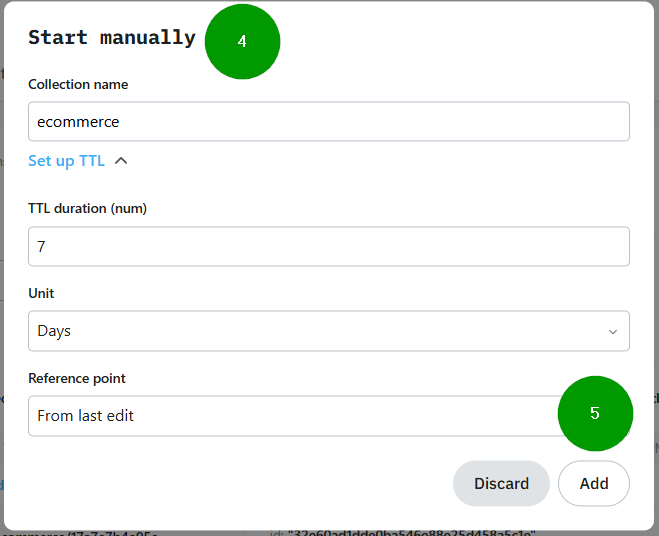
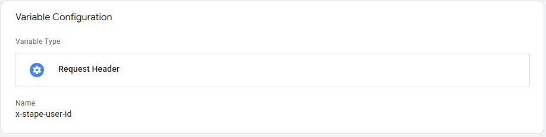
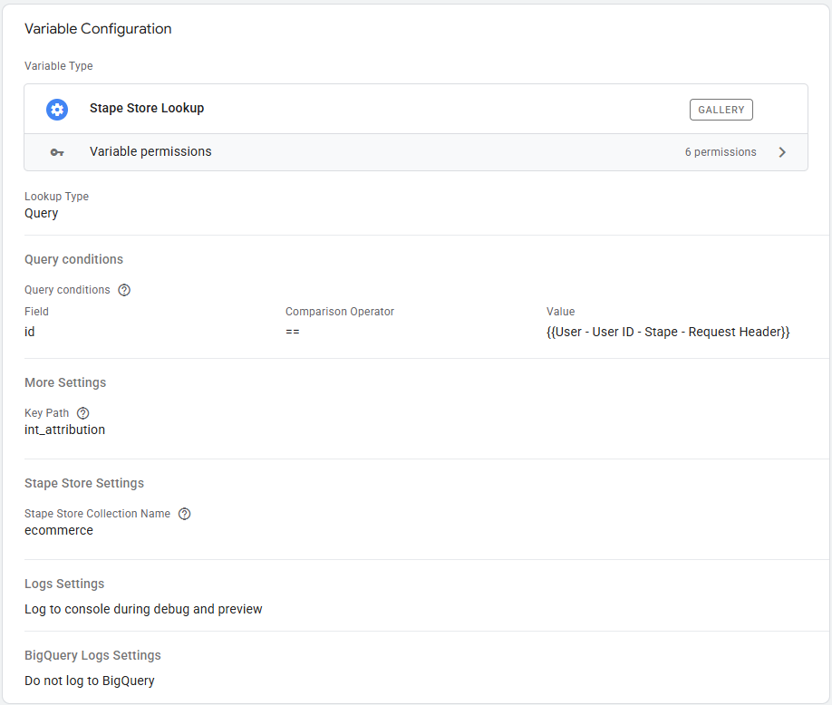
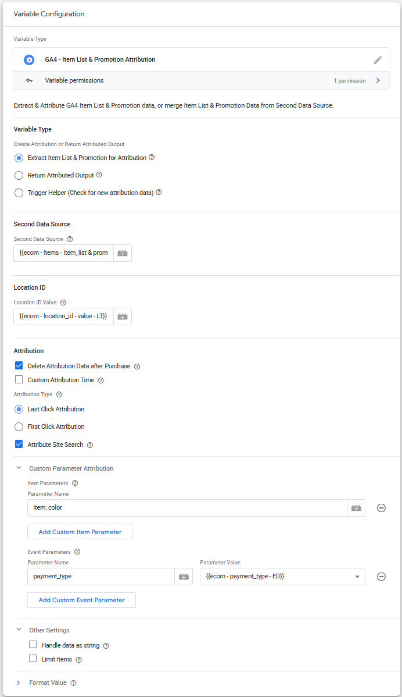
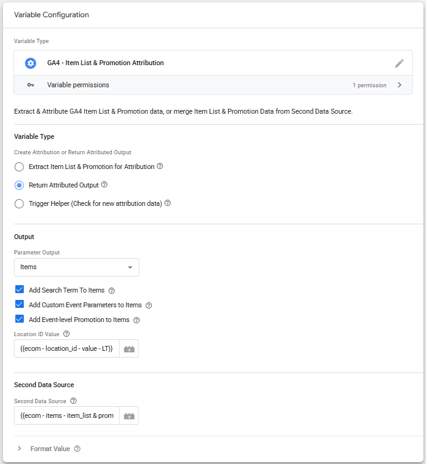
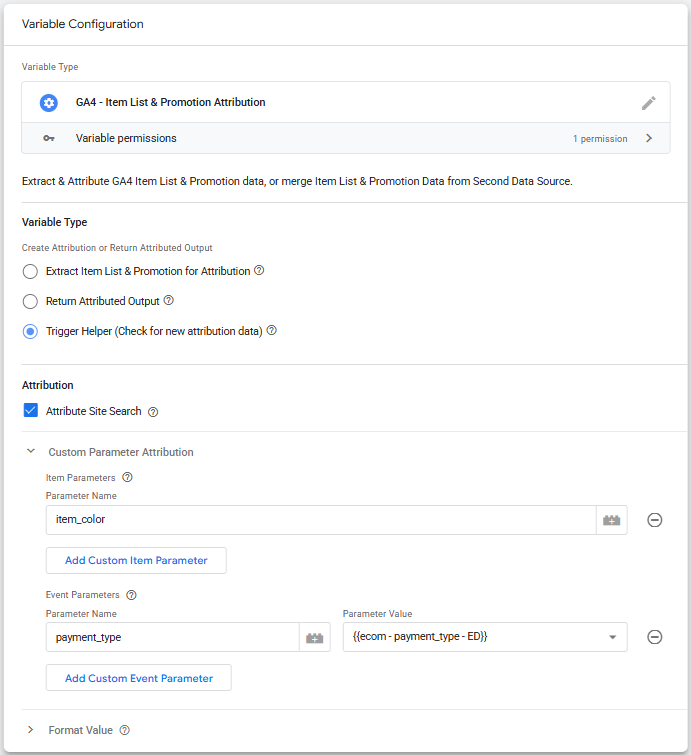
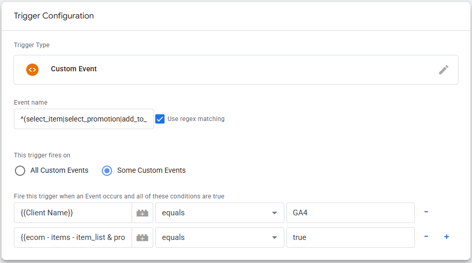
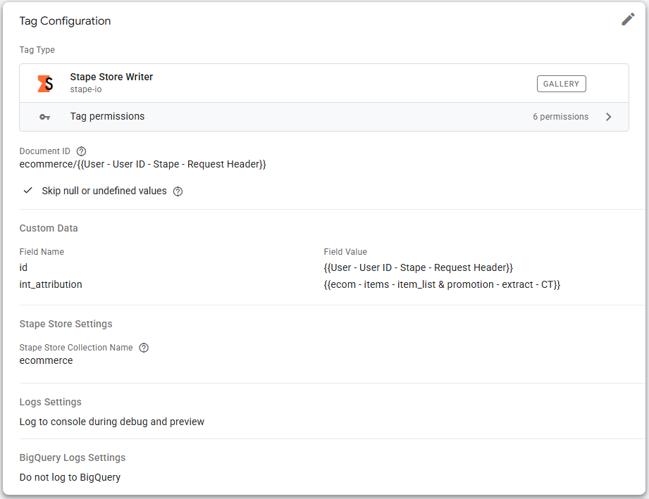
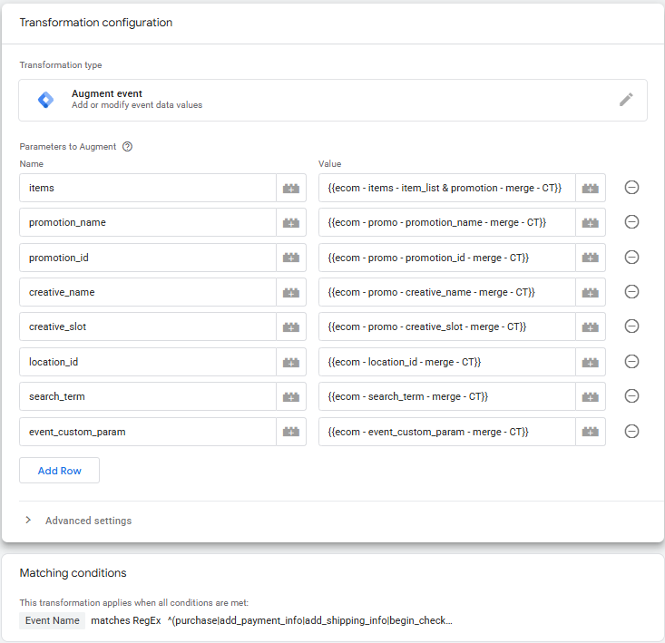

# Stape Data Store Setup
[Data Store](https://stape.io/helpdesk/documentation/data-store-feature?pt=vsahefle&rs=site&rr=eu) is available for **Stape customers** with a Pro or higher plan at no additional cost at the time of writing. Data Store was previously called **Stape Store**. The GTM templates are still called **Stape Store Writer** and **Stape Store Lookup**.

## Data Store Setup 
1. After you have logged in to your Stape account, open your sGTM container and go to the **Data Store** tab.
2. Click **Add collection**.
3. Select **Start manually**.
4. Start manually settings:
	* **Collection name**: ecommerce
	* **TTL duration**: 7
		* This is how long the document will live before it is automatically deleted. I use 7 days, but set what suit you best.
	* **Unit**: Days
	* **Reference point**: From last edit
5. **Add**

Data Store setup completed.

## Power-Ups
We need to use an identificator (ID) in Data Store. One solution is to use the [**Stape User ID**](https://stape.io/solutions/user-id?pt=vsahefle&rs=site&rr=eu).
Another solution is to user **GA4 Client ID** as described in the [**Firestore setup**](../01-Firestore/README.md#ga---client_id---ed).

In this documentation we will use Stape User ID.

* To enable User ID in your Stape account, choose Power-Ups, choose **User ID** and click **Use** button. 

# Server-side GTM Setup

If you are setting this up for **App data**, see [**App setup**](../README.md#app-setup) for what is different (identifier and Client Name).

Install the following Server-side GTM Templates:
* [**GA4 - Item List & Promotion Attribution**](https://tagmanager.google.com/gallery/#/owners/gtm-templates-knowit-experience/templates/sgtm-ga4-ecom-item-list-promo-attribution) (this Variable Template)
* [**Stape Store Writer**](https://tagmanager.google.com/gallery/#/owners/stape-io/templates/stape-store-writer-tag) (Tag)
* [**Stape Store Lookup**](https://tagmanager.google.com/gallery/#/owners/stape-io/templates/stape-store-lookup-variable) (Variable)

## Create Variables
We must create some Variables. Suggested Variable names are listed below, and are also used throughout the documentation.
*	ecom - attribution time - minutes - C
*	User ID - Stape - Request Header
*	ecom - items - item_list & promotion - Stape Lookup
*	ecom - items - item_list & promotion - extract - CT
*	ecom - items - item_list & promotion - merge - CT
*	++

### ecom - attribution time - minutes - C
As standard, attribution time is the same as a **[GA4 Session](https://support.google.com/analytics/answer/9191807)**, but you can choose a **Custom Attribution Time** if that better fits your users behaviour.

Create this variable if you are going to use **Custom Attribution Time**.

Since attribution time is referenced in several variables, it’s recommended to create a Constant Variable with the attribution time in minutes.
How long the custom attribution time should be is up to you. Time is counted from the last **select_promotion**, **select_item** or **add_to_cart** Event. 

* Name the Variable **ecom - attribution time - minutes - C**.

### Stape User ID
The Stape User ID is going to be used as an identifier in this setup.

Create an **Request Header** Variable and add **x-stape-user-id** as **Name**.

*	Name the Variable **User ID - Stape - Request Header**.

### ecom - items - item_list & promotion - Stape Lookup
We are using the **Stape Lookup** to read data from Data Store. You can query Data Store using either **Document ID**, or **Query**.

How to name and organize your Data Store document is up to you, but these are the settings used in this example:

*	**Lookup Type'': Query
*	**Stape Store Collection Name:** ecommerce
*	**Field:** _id ==_ {{User ID - Stape - Request Header}}
*	**Key Path:** int_attribution
*	**Store the result in cache:** _Leave unchecked_
*	**Use the Stape Store database of a different container:** _false_

* Name the Variable **ecom - items - item_list & promotion - Stape Lookup**.

### ecom - location_id - value - LT
This variable returns the value that is going to be used as **location_id**. The same variable is used for both Web and App.

For Web, **location_id** is the **Page Path** where **select_item** or **select_promotion** happened. Apps don't have a Page Path, so the **screen name** is used instead.

Create a **Lookup Table** Variable:
* **Input Variable:** {{Client Name}}
* **Lookup Table**

| Input  | Output |
| ------------- | ------------- |
| GA4 (the name of your GA4 Client for Web) | {{Page Path}} |
| GA4 - App (the name of your GA4 (App) Client) | {{app - screen - ED}} |

**{{app - screen - ED}}** is an **Event Data** Variable with **screen** as **Key Path**. If you only have Web or only App, you only need that row.

* Name the Variable **ecom - location_id - value - LT**.

### ecom - items - item_list & promotion - extract - CT
Select the **GA4 Ecommerce – Item List & Promotion Attribution** Variable (this Template). This variable will **extract Item List & Promotion dat**a from GA4 Ecommerce and create the attribution. With other words, attribution happens at collection time.

This variable will do both Data Store Read and Write.

* **Variable Type:** Extract Item List & Promotion for Attribution
* **Second Data Source:** {{ecom - items - item_list & promotion - Stape Lookup}}
* **Location ID**
  * **Location ID Value:** {{ecom - location_id - value - LT}}
    * The value is only used where an Item List or Promotion is implemented on the Event or the Item, and **location_id** is missing. An **add_to_cart** from an Item List gets the value, an add_to_cart from a product page does not.
* **Attribution**
  * **Delete Attribution Data after Purchase:** Tick this box to delete/reset attribution data after a purchase has happened.
    * This is the only place you tick this setting. The trigger helper variable always returns true for **purchase**, so you only have to make sure that **purchase** is included in the trigger.
    * You only need this setting for the Variable that attribute Items. Not necessary for Event-level attribution Variables.
  * **Custom Attribution Time:** Tick this box if you are using **Custom Attribution Time**
    * **Attribution Time in Minutes:** {{ecom - attribution time - minutes - C}}
  * **Attribution Type:** Select Last or First Click Attribution
  * **Attribute Site Search:** Tick this box if you want to attribute **search_term**.
* **Custom Item & Event Parameter Attribution**
  * Any Item & Event Parameter can be attributed.
  * Add parameters you want to attribute as shown in the image below.
* **Other Settings**
  * **Handle data as string:** This will save attribution data as a string. Recommended.
  * **Limit Items:** This will limit number of Items stored. Not relevant when using Data Store.

* Name the Variable **ecom - items - item_list & promotion - extract - CT**.

### ecom - items - item_list & promotion - merge - CT

Select the **GA4 Ecommerce – Item List & Promotion Attribution Variable** (this Template). This Variable merges Implemented data & data from Second Data Source (Data Store).

* **Variable Type:** Return Attributed Output
* **Output:** Items
* **Add Search Term To Items:** If you tick this checkbox, **search_term** will be added to **items**. This makes it easier to report search_term related to items. You must create an **Item scoped Dimension** in GA4.
  * This selection is only available for **Items**
* **Add Custom Event Parameters to Items:** If you tick this checkbox, **custom_event_param** will be added to **items**. You must create an **Item scoped Dimension** in GA4.
* **Add Event-level Promotion to Items:** If you tick this checkbox, the stored Event-level promotion (**promotion_id**, **promotion_name**, **creative_name**, **creative_slot** and **location_id**) is added to items that don't have a promotion of their own. Items with the same promotion also get the stored **location_id**.
* **Second Data Source:** {{ecom - items - item_list & promotion - Stape Lookup}}
* **Location ID Value:** {{ecom - location_id - value - LT}}
* Attribution time has no setting in this variable. It follows the attribution time that the **extract** variable stored together with the data.

*	Name the Variable **ecom - items - item_list & promotion - merge - CT**.

In addition, you must create **Promotion & Search Term Variables** using the same Variable Type if you have implemented **Promotion without Items**, or if you want to attribute **Search Term**:

| Variable Name  | Output |
| ------------- | ------------- |
| ecom - location_id - merge - CT | Location ID (**Location ID Value:** {{ecom - location_id - value - LT}}) |
| ecom - promo - creative_name - merge - CT | Creative Name |
| ecom - promo - creative_slot - merge - CT | Creative Slot |
| ecom - promo - promotion_id - merge - CT | Promotion ID |	
| ecom - promo - promotion_name - merge - CT | Promotion Name |	
| ecom - search_term - merge - CT | Search Term |	
| ecom - event_custom_param - merge - CT | Add Custom Event Parameters if relevant |	

### ecom - items - item_list & promotion - trigger helper - CT

If you are using Firestore or Data Store, it is recommended to create a **trigger helper variable**.
The purpose of this variable is to reduce unnecessary Firestore or Data Store Reads.

* If you are attributing **Custom Event** or **Custom Item** parameters, add them to the variable as shown below.
* If you are attributing **Search Term**, tick the **Attribute Site Search** checkbox as shown below.

*	Name the variable **ecom - items - item_list & promotion - trigger helper - CT**.

## Trigger

### ecom - Attribute Events - Item List & Promotion

Create a Custom Trigger Type with the following settings:  
* **This trigger fires on:** Some Events
* **Client Name** _equals_ GA4 (the name you have given your GA4 Client)
* **Event Name** *matches RegEx* ^(select_item|select_promotion|add_to_cart|purchase)$
  * **purchase** Event in RegEx is only needed if you want to delete/reset attribution data after purchase. Leave it out otherwise, since the trigger helper variable always returns true for **purchase**.
  *  If you are going to attribute **search_term** as well, RegEx should be **Event Name** *matches RegEx* ^(select_item|select_promotion|add_to_cart|purchase|search|view_search_results)$
    * **search** is Google's recommended event name for site search. **view_search_results** is the name used by older implementations and by GA4 Enhanced Measurement. Keep only the one(s) you use.
* **ecom - items - item_list & promotion - trigger helper - CT** _equals_ true

*	Name the Trigger **ecom - Attribute Events - Item List & Promotion**.

## Tags

### GA4 - Item List & Promotion Attribution - Stape Store Writer
Select the [**Stape Store Writer** Tag](https://tagmanager.google.com/gallery/#/owners/stape-io/templates/stape-store-writer-tag), and add the following settings:

* **Document ID:** ecommerce/{{User - User ID - Stape - Request Header}}
* **Skip null or undefined values:** ✅
* Custom Data
  * **Field Name:** int_attribution
	* **Field Value:** {{ecom - items - item_list & promotion - extract - CT}}
  * **Field Name:** id
	* **Field Value:** {{User - User ID - Stape - Request Header}}

* Add **ecom - Attribute Events - Item List & Promotion** as a **Trigger** to the Tag.

## Transformations

### GA4 - Ecom - Item List & Promotion - Augment

* Select the **Augument Event Transformation**

#### Parameters to Augment
| Name  | Value |
| ------------- | ------------- |
| items | {{ecom - items - item_list & promotion - merge - CT}} |
| promotion_name | {{ecom - promo - promotion_name - merge - CT}} |
| promotion_id | {{ecom - promo - promotion_id - merge - CT}} |
| creative_name | {{ecom - promo - creative_name - merge - CT}} |	
| creative_slot | {{ecom - promo - creative_slot - merge - CT}} |	
| location_id | {{ecom - location_id - merge - CT}} |
| search_term | {{ecom - search_term - merge - CT}} |	
| event_custom_param | {{ecom - event_custom_param - merge - CT}} |

#### Matching conditions

You must minimum add the events below, but you can add the attribution to ex. all the steps in the checkout if you like.

* **{{Event Name}}** _matches RegEx_ ^(purchase|begin_checkout|add_to_cart)$

#### Affected tags

* Some Tags
    * **Included tags:** GA4

### GA4 - Ecom - Location ID - Augment

This Transformation adds **location_id** to the Events where an Item List or a Promotion is clicked. It is the same for Web and App.

* Select the **Augment Event Transformation**

#### Parameters to Augment
| Name  | Value |
| ------------- | ------------- |
| location_id | {{ecom - location_id - value - LT}} |

#### Matching conditions

* **{{Event Name}}** _matches RegEx_ ^(select_item|select_promotion)$
  * Add **view_item_list** and **view_promotion** to the RegEx if you want **location_id** for these Events as well.

#### Affected tags

* Some Tags
    * **Included tags:** GA4 (all your GA4 Tags, both Web and App)

**add_to_cart** is not part of this Transformation. It is handled by the **Location ID Value** setting in the Template, so **location_id** is only added when the Item is added to cart from an Item List, and not from a product page.

Your Server-side GTM setup is now complete.

---

Solution by [**Eivind Savio**](https://www.savio.no/google-tag-manager/ga4-item-list-promotion-search-term-attribution-with-gtm?utm_source=github.com&utm_medium=referral&utm_campaign=knowit-ai-analytics&utm_content=sgtm-ga4-ecom-item-list-promo-attribution) from [**Knowit AI & Analytics**](https://www.knowit.no/?utm_source=github.com&utm_medium=referral&utm_campaign=knowit-ai-analytics&utm_content=sgtm-ga4-ecom-item-list-promo-attribution) (Oslo, Norway). Not officially supported by Knowit.
